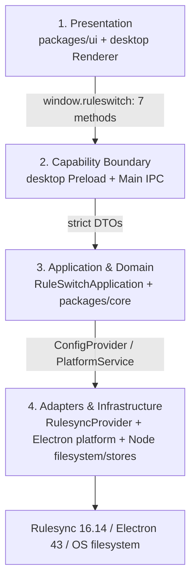

# Architecture Overview

## Implemented Baseline

**v1.0 主线（M0–M6）** 已在 macOS 验证：`packages/core/src/v2/` 提供身份、reconcile、apply-plan、batch-apply、GitPort、Harness adapter、stores 与 IPC v2 契约；`apps/desktop/src/main/infrastructure/{git,harness}` 提供真实实现；`CapabilityServiceV2` 是唯一 v2 读写入口（21 通道）。

**M7** 提供七页产品 shell（`packages/ui/src/app-v2.tsx`），只消费 Main 产出的 read model。

**Phase A** walking skeleton 仍在兼容窗口内：真实 Electron Main/Preload/Renderer、RulesyncProvider、React UI、capability filesystem、filesystem-first transaction stores 与 Playwright E2E 串起 Open → Raw/Rendered → Open External → Stage → Generated/Diff → Apply/Verify → History → Restore。其 transaction / snapshot / ownership / path 语义是 v1 复用的安全基线。

## Four Layers and Dependency Direction



这是运行时调用方向。编译期 `packages/core` 声明 contracts/ports，不依赖 Electron、React、Rulesync；adapters 依赖 core，Main 是 composition root。Renderer 不得绕过 preload，provider 不得依赖 UI。

构建/包装另有边界但不改变四层：desktop package 无 Rulesync 直接依赖并 externalize provider；`@ruleswitch/rulesync-provider` 用自己的 esbuild 0.27.7 将 adapter 内部模块 bundle 为单一 ESM 入口，Rulesync 保持 provider 的 external dependency。

## Actual Modules

| File/package | Responsibility |
| --- | --- |
| `packages/core/src/contracts.ts` | v1 entities、SHA-256 revision、transaction/history types |
| `packages/core/src/schemas.ts` | strict Zod invariants，包括 provider-neutral logical path |
| `packages/core/src/ipc.ts` | `ApiResult`、7-method DesktopApi、request/response schemas、versioned channels |
| `packages/core/src/ports.ts` | `ConfigProvider`、`PlatformService`、`HashService` ports |
| `packages/core/src/transactions.ts` | frozen transition graph and terminal states |
| `apps/desktop/src/main/index.ts` | composition root、BrowserWindow hardening、navigation deny |
| `apps/desktop/src/main/ipc.ts` | sender ID + main-frame processId/routingId check、双向 schema validation、error mapping |
| `RuleSwitchApplication` | session relationship checks、staging context、Apply/Restore orchestration、mutex/recovery gate |
| `NodeFilesystemInfrastructure` | roots/resources registry、canonical/realpath/case policy、hash、atomic write/delete |
| `DesktopStores` | internal snapshot manifest v2/payload/ownership metadata、transaction manifest、history、ownership stores |
| `ElectronPlatformService` | directory picker、`app.getPath("userData")`、authorized `shell.openPath` |
| `packages/rulesync-provider` | `.rulesync` detect/validate、safe enumeration、Programmatic API staging、ChangeSet |
| `packages/ui` | Phase A workbench、Monaco Editor/DiffEditor、inert sanitized Markdown |
| `tests/integration`, `tests/e2e` | real Rulesync/application integration and sandboxed Electron UI flow |

## v1.0 Modules (M0–M7)

| File/package | Responsibility |
| --- | --- |
| `packages/core/src/v2/identity.ts`、`project-binding.ts`、`profiles.ts` | 稳定 repository/project/asset/harness 身份、ProjectDefinition、profile 优先级 |
| `packages/core/src/v2/repo-layout.ts`、`ruleswitch-yaml.ts` | Config Repo layout 与 typed manifest 解析 |
| `packages/core/src/v2/reconcile.ts`、`reconcile-engine.ts`、`conflict.ts` | B/L/D 真值表、ApplyMode 解析、冲突模型 |
| `packages/core/src/v2/apply-plan.ts`、`batch-apply.ts` | 逐目标计划（含 needs-adoption / add-only 短路）与 journaled batch |
| `packages/core/src/v2/git-port.ts` | FF-only、scoped commit、fetch+revalidate push、Index 契约 |
| `packages/core/src/v2/harness-adapter.ts`、`harness-capabilities.ts` | Adapter 7 方法契约与四 Harness 能力矩阵（路径 + 每 kind 能力） |
| `packages/core/src/v2/stores.ts`、`ipc-v2-channels.ts` | versioned store envelope / 迁移 gate；21 个 v2 通道与 `ApplyOutcome` |
| `apps/desktop/src/main/application/capabilities-v2.ts` | 唯一 v2 读写入口：read model + 编辑器读取 + apply 目标解析 |
| `apps/desktop/src/main/infrastructure/git/*` | Git runtime/porcelain、identity/binding/sync-state、credential diagnostics |
| `apps/desktop/src/main/infrastructure/harness/*` | adapter v2 渲染与 skill slice 事务写入（snapshot→write→verify） |
| `packages/ui/src/app-v2.tsx`、`dialog.tsx`、`*-model.ts` | 七页 shell、应用内确认面、纯函数 model 层 |

## Frozen Model and Revisions

v1 baseline 包含 `Workspace`、`Profile`、`Target`、`FileResource`、`ChangeSet`、`Snapshot`、`ApplyTransaction`、`HistoryEntry`、`ConfigProvider`、`PlatformService`，以及 IPC/transaction/security/path/storage semantics。Phase A session 固定一个 universal Rulesync profile、一个 `codexcli/rules` target。

Main 让 Renderer 只看到 opaque `FileResource.id` 与 logical metadata。Root/resource registry 绑定 workspace、canonical path、origin 和 operation set。SHA-256 aggregate 按 `resourceId` 排序，对 `[resourceId,digest,byteLength]` UTF-8 JSON tuples hash，marker 为 `ruleswitch:file-revision-set:v1`。

## Seven Narrow IPC Methods

| Method | Strict request | Result |
| --- | --- | --- |
| `openWorkspace()` | `{}` | `WorkspaceSessionDto` |
| `readResource(resourceId)` | resource capability | raw-byte `ResourceContentDto` |
| `openExternal(resourceId)` | resource capability | `null` |
| `stageTarget(workspaceId, profileId, sourceResourceId, targetId)` | related session IDs | `ChangeSet` |
| `applyChangeSet(changeSetId)` | staged ready ID | `ApplyTransaction` |
| `listHistory(workspaceId)` | active session ID | `HistoryEntry[]` |
| `restoreHistory(historyEntryId)` | owned history ID | `ApplyTransaction` |

Preload validates before invoke；Main matches sender WebContents ID and main-frame `processId`/`routingId`, validates requests and responses, and exposes typed errors. `openExternal` additionally accepts only source-origin resources. Generic path/fs/shell/command channels remain forbidden。

## Implemented Flows

```text
Dialog/test-only Main env selection
→ workspace realpath + root capability
→ provider detects .rulesync Markdown
→ resource read / authorized shell.openPath
→ source tree enumerate + hash before
→ Rulesync output to app-data staging
→ hash after + generated/current resources + ChangeSet
→ UI first-change Generated/Diff
→ stale preflight + raw-byte/ownership snapshot + transaction ledger
→ atomic write + reread/hash + ownership/history + COMMITTED
→ restore source snapshot after first snapshotting current state
→ commit affected ownership from source snapshot for reversible create/delete
```

The application handles all ChangeSet entries in deterministic logical-path order; Phase A UI only renders the first entry.

## Storage

`app.getPath("userData")` contains `staging/stage-*`, `snapshots/<workspace>/<snapshot>/{manifest.json,files/*.bin}`, `transactions/<id>/manifest.json`, `history/<workspace>/entries.json`, and `ownership/<workspace>/manifest.json`. Internal snapshot manifest is version 2 and stores affected-path capture-time ownership metadata beside raw bytes/hash; payload names are strictly `files/NNNNNN.bin` and containment-checked. Core `Snapshot` public contract remains unchanged. Transaction/history/ownership stores remain version 1. All are schema-validated and atomically written with fsync. Profiles and stable workspace identity are not yet persisted.

## Verification and Boundaries

Windows evidence: Node 22.18.0/Electron 43.4.1; unit 35、integration 13、E2E 1；中文+空格 workspace、real default open、Rulesync staging、Monaco diff、Apply/Verify/History/Restore、BOM+CRLF exact restore、unknown unchanged。Integration 还覆盖 reversible create/delete ownership、commit metadata failure rollback 与 tampered snapshot traversal rejection。macOS/Linux 未测试。

Phase A does not include watcher/auto refresh（`chokidar` 尚未依赖）, multi-target/feature UI, all-ChangeSet-item presentation, cross-restart history rebind, or packaging/signing/CI。Path-based write TOCTOU 与完整 crash repair 是 P2 残余；仍需 crash-phase、rollback-itself-failure 和 native-platform matrices。
