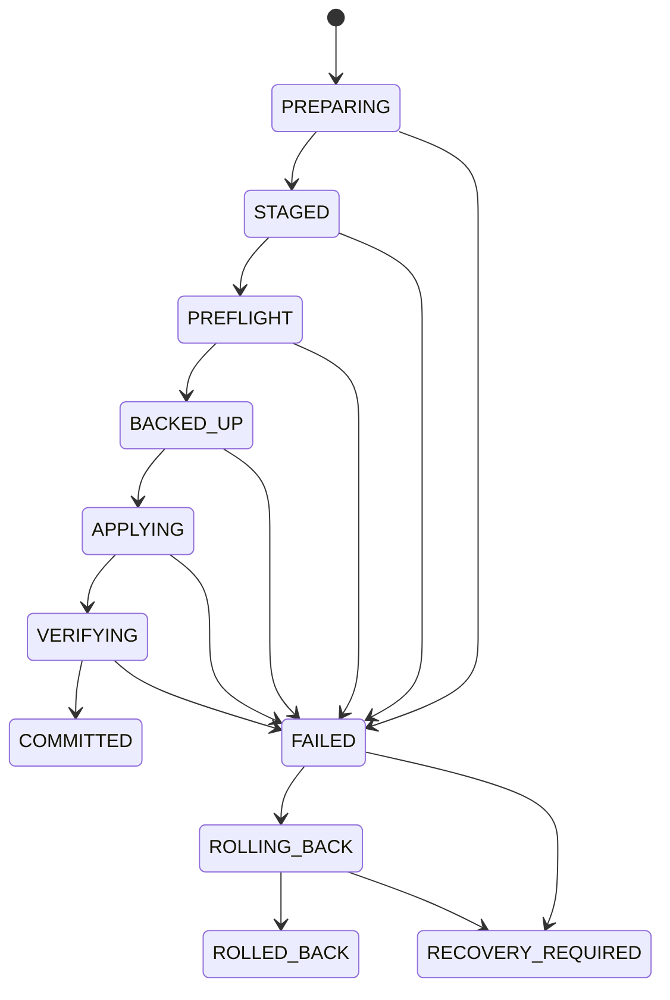

# Preview-first Transactions

## Implemented Status and Invariants

Phase A 已实现 production application transaction executor、workspace mutex、raw-byte snapshot store、atomic writer、versioned transaction/history/ownership stores、rollback、Restore 和 startup manifest scan。Frozen v1 invariants 与 core `Snapshot` public contract 不变：Preview 只写 staging；Apply 前 stale preflight；mutation 前 snapshot；写后 verify；失败 rollback；rollback 无法验证则 `RECOVERY_REQUIRED`；unknown delete fail closed；Restore 自身也是 transaction。Internal snapshot manifest 已升级为 version 2，以持久化 capture-time ownership metadata。

## State Machine



`COMMITTED`、`ROLLED_BACK`、`RECOVERY_REQUIRED` 为 terminal。`assertTransactionTransition` 禁止跳级、反向和 self transition。Application 每次 transition 都先原子持久化 manifest，并记录结构化 state log。

- `PREPARING`：创建 transaction/ledger、持久化 manifest；调用入口已持有 workspace mutex。
- `STAGED`：Apply 验证 generated aggregate；Restore 验证 source snapshot payload。
- `PREFLIGHT`：重验 source/target/generated 或 Restore ownership。
- `BACKED_UP`：exact current bytes/absence 已保存并将 snapshot ID 写入 manifest。
- `APPLYING`：按 logical path 排序 mutation，前后更新 ledger。
- `VERIFYING`：从 workspace 重读并核对 hash/length/absence。
- `COMMITTED`：ownership/history 写入成功后才完成。
- `FAILED → ROLLING_BACK`：按 snapshot 逆序恢复并 verify。
- rollback 路径自身失败：`RECOVERY_REQUIRED`、保留证据并 gate 当前 workspace mutation。

## Actual Apply Flow

`applyChangeSet` 只接受当前进程 `staged` registry 中 status 为 `ready` 的 ChangeSet，校验 workspace/profile/target/provider relationship，然后在 workspace mutex 中：

1. 保存 `PREPARING` manifest，转 `STAGED`，重算 staging generated aggregate；
2. 转 `PREFLIGHT`，provider 重新枚举/validate source 并比较 source aggregate；逐项读取 target，比较 `before` digest/length/existence，再比较 target aggregate；再次验证 generated；
3. capture affected paths 的 exact bytes/absence，以及 digest 匹配的当前 ownership，`DesktopStores.saveSnapshot` 写 payload/manifest-v2，转 `BACKED_UP`；
4. 转 `APPLYING`，跳过 unchanged，其他 change 在 ledger 标记 started/completed；
5. create/modify 从 generated resource 读取 bytes，经 `write-file-atomic` `{fsync:true}` 写 target，立即验证 digest/length；delete 需 ownership + ledger + expected digest；
6. 转 `VERIFYING`，再次从 workspace 重读全部 paths；
7. 更新 ownership、append apply history，最后转 `COMMITTED`。

如果 ownership/history/commit metadata 写入出错，application 先尝试撤销刚追加的 history并恢复 commit 前 ownership，再使用 snapshot rollback。Integration 已验证 metadata failure 后 workspace、ownership、history 都回到原状态。Provider Phase A 不产生 delete Change，但 delete safety primitive 已存在。

## Snapshot Store

Actual layout：

```text
snapshots/<workspace-id>/<snapshot-id>/
  manifest.json
  files/000000.bin
  files/000001.bin
transactions/<transaction-id>/manifest.json
history/<workspace-id>/entries.json
ownership/<workspace-id>/manifest.json
```

Internal snapshot manifest 当前为 version 2。它记录 IDs、provider/version、timestamp、logical path、`existed`、SHA-256、payload relative name，以及每个 affected path 在 capture 时与 bytes digest 匹配的 ownership metadata。Core `Snapshot` public contract 仍只有原有 snapshot/file fields，没有暴露 internal ownership。

存在文件保存原始 `Uint8Array` 到 `.bin`；不存在项无 hash/payload。Payload 只允许精确 `files/NNNNNN.bin` 形式，并在 resolve 后再做 snapshot-root containment；Load 时 strict schema、storage ownership、containment 和 payload digest 全部验证。BOM/CRLF 不经过 decode/encode，Windows integration/E2E 已证明 restore exact bytes；tampered traversal manifest 由 integration 验证为 fail closed。

Transaction manifest version 1 实际记录 transaction、profile/target/root IDs、workspace root identity、provider/version、per-path kind/expected digest/mutationStarted/mutationCompleted ledger 与 failure code。它不保存文件内容；snapshot 承担恢复证据。History/ownership stores 也仍为 version 1。

## Rollback and `RECOVERY_REQUIRED`

任何 Apply/Restore 错误转 `FAILED → ROLLING_BACK`。Snapshot 原来存在的文件通过同一 atomic primitive 写回；原来不存在但当前存在的文件，只有 ledger 证明 mutation completed 且当前 digest 等于 expected generated digest 时才能删。之后 `verifyRestored` 核对 exact digest/absence，成功为 `ROLLED_BACK`。

Rollback write/delete/verify 或状态持久化失败会尝试转 `RECOVERY_REQUIRED`，保留 snapshot/manifest，并对当前 session workspace 加 mutation gate；API 返回 `RECOVERY_REQUIRED`，不得伪报成功。Rollback-failure simulation 尚未加入当前 test record。

启动 `initialize()` 扫描 transaction store：对非 terminal manifest 记录 workspace ID/root identity 并加 recovery gate；重新打开同一 canonical root 时阻止 Apply/Restore。当前仅有 manifest scan、结构化日志和 mutation gate，没有 repair/diagnostics UI，也没有自动安全修复。Crash-at-every-phase、损坏 manifest repair 和跨进程恢复矩阵仍待实现/验证。

## Restore Is a Transaction

UI 当前选择 latest apply history。`restoreHistory` 从 history store 查 entry，要求其 workspace ID 对应当前 session，加载并验证 desired source snapshot；接着计算当前→desired changes，创建 `operation:"restore"` manifest。在 mutation 前 snapshot 当前状态，按同一状态机 Apply desired bytes/absence、verify；commit 时仅替换 affected paths，并以 source snapshot capture 的 ownership 恢复它们，然后 append restore HistoryEntry，记录 `restoredFromHistoryEntryId`。因此该 restore 产生的 current snapshot 可用于后续反向恢复，虽然 Phase A UI 只提供“Restore latest apply”。

这使 create → Restore delete → reverse Restore recreate 可安全往返：source snapshot 没有 ownership 的原用户文件不会因恢复 bytes 被错误认领，原本 owned 且 digest 匹配的文件才恢复 ownership。如果 desired 表示原路径不存在而当前有文件，仍必须以当前 ownership/profile/provider/digest 证明可删；否则拒绝 Restore。

## History and Identity Limitation

History 按 `workspaceId` 存 `entries.json`，entry 关联 transaction/snapshot/changeSet 或 restored source。Phase A 的 workspace/profile/target IDs 在每次 `openWorkspace` 时随机生成；没有 stable workspace metadata/rebind，因此跨应用重启后，旧 history 不会自动绑定到新 session。实现重绑定前不得宣称 persistent history 可跨重启使用。

## Concurrency and Stale Protection

每个内存 workspace ID 有 FIFO promise mutex，防同进程窗口/调用并发 Apply/Restore。它不防外部编辑。Apply 的 source/target/generated preflight 是 stale overwrite 防线。Phase A 无 watcher/auto refresh；用户在 Preview 后外改 target，会在 Apply 前得到 `STALE_CHANGE_SET`，真实外改保持不变。

但 path-based write 的最终检查与 filesystem mutation 之间仍有 check/use TOCTOU 窗口；这是 P2 残余，现有 mutex、preflight、realpath 和 post-write verify 不能被描述为已彻底解决。

## Verification Evidence and Gaps

Windows integration 已覆盖成功 Apply/History/Restore、BOM+CRLF exact snapshot restore、unknown preservation、stale target rejection、atomic-write failure rollback、forged/cross-workspace IDs、create/delete/reverse Restore ownership、commit metadata failure rollback 和 tampered snapshot traversal。E2E 已走真实 UI Apply/Verify/History/Restore。当前记录：integration 13，E2E 1。

仍待：rollback itself failure、partial multi-file crash、每个 state crash、path-based write TOCTOU、permission/readonly/verify mismatch 更完整 fault matrix、stable cross-restart identity/rebind、完整 crash repair/repair UI，以及 macOS/Linux native atomic/locking tests。
